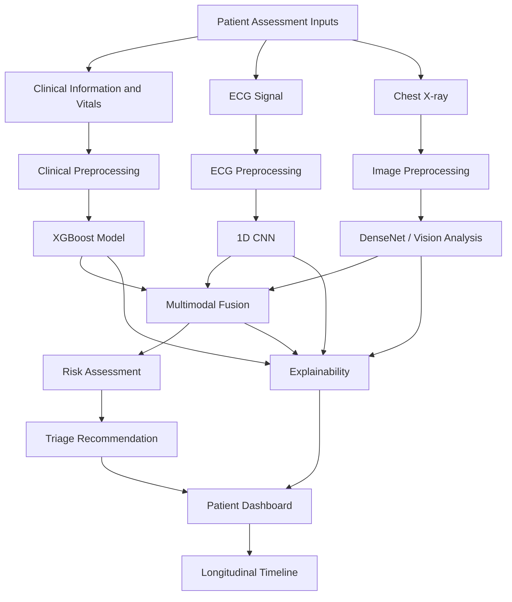
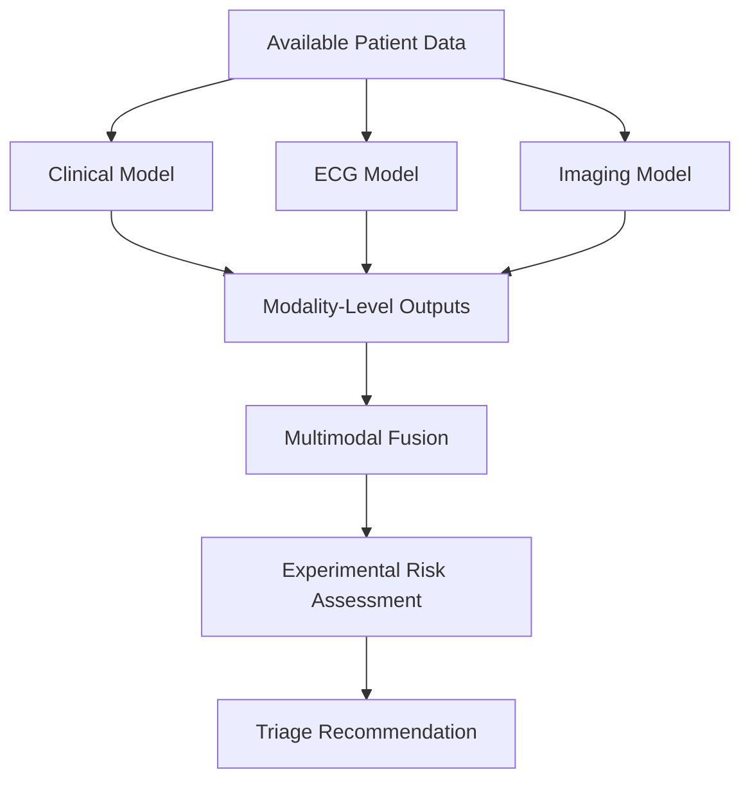
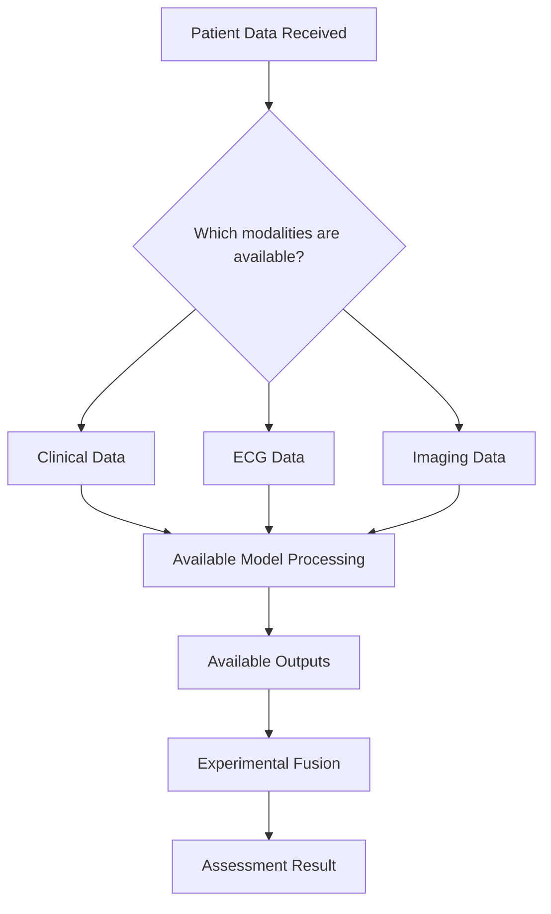
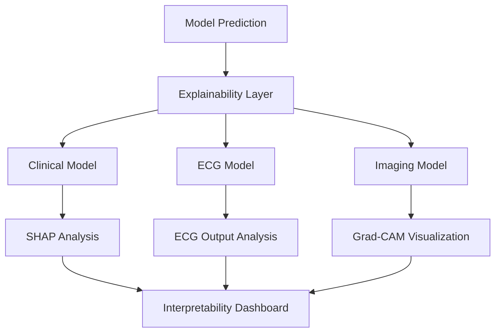
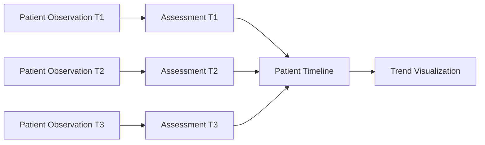

# TRIAGEAI — AI-Based Multimodal Diagnostic Triage System

**An AI-assisted multimodal system for patient assessment, risk estimation, and emergency triage prioritization.**

> **Project Status:** Academic Research Prototype  
> **Project Type:** Capstone Project  
> **Domain:** Artificial Intelligence · Healthcare · Multimodal Machine Learning · Explainable AI

---

## 1. Overview

TRIAGEAI is an AI-based multimodal triage system designed to explore how information from multiple clinical modalities can be integrated to support patient assessment and emergency prioritization.

The system combines structured clinical information, vital signs, electrocardiogram (ECG) signals, and chest X-ray (CXR) images to generate an experimental patient risk assessment and triage recommendation.

The project explores modality-specific machine learning models, multimodal fusion, explainability techniques, missing-modality handling, and longitudinal patient monitoring.

TRIAGEAI is developed as an academic research prototype. Its predictions are intended for research and demonstration purposes and have not been validated for real-world clinical decision-making.

### Key Features

- Multimodal patient assessment using clinical information, vital signs, ECG, and chest X-rays
- Clinical risk prediction using XGBoost
- ECG signal classification using a 1D CNN
- Chest X-ray analysis using DenseNet
- Experimental multimodal risk fusion
- Five-level KTAS-inspired triage prioritization
- Explainable AI using SHAP and Grad-CAM
- Missing-modality handling
- Longitudinal patient assessment and timeline visualization
- Safety-oriented rule-based overrides
- REST API built using FastAPI
- React-based frontend
- MongoDB integration with local storage fallback

---

## 2. System Architecture

TRIAGEAI follows a modular architecture in which each input modality is processed by a dedicated model or processing pipeline. The resulting outputs are integrated into an experimental multimodal assessment.



### Architecture Components

| Component | Description |
|---|---|
| Clinical Input | Structured patient information and clinical features |
| Clinical Model | XGBoost-based risk prediction |
| ECG Pipeline | ECG signal preprocessing and classification using a 1D CNN |
| Imaging Pipeline | Chest X-ray analysis using DenseNet and vision-based analysis |
| Fusion Layer | Combines available modality-level outputs |
| Triage Layer | Produces an experimental risk assessment and triage recommendation |
| Explainability | Provides model interpretation using SHAP and Grad-CAM |
| Timeline | Supports visualization of patient assessments over time |
| Backend | FastAPI services and API endpoints |
| Frontend | React-based user interface |
| Storage | MongoDB with local storage fallback |

---

## 3. Dataset and Model Information

TRIAGEAI uses datasets and derived model artifacts for its experimental pipelines.

### 3.1 Clinical Dataset

**Emergency Service Triage Dataset**

- Approximate records: 1,267
- Features: 24 columns
- Used for clinical risk prediction and triage classification
- Processed using a clinical preprocessing pipeline and XGBoost

### 3.2 ECG Dataset

**ECG Signal Dataset**

- Approximate ECG records/beats: 123,998
- Used for ECG signal preprocessing and classification
- Processed through a 1D CNN architecture

### 3.3 Chest X-ray Dataset

**NIH ChestX-ray14**

- Approximate images: 112,120
- Used for chest X-ray analysis
- Supports the imaging pipeline and DenseNet-based model

### 3.4 Symptom Matching

The symptom-matching component includes approximately 41 disease entities and is used for symptom-based information matching within the application.

### 3.5 Longitudinal Data

The longitudinal demonstration data contains approximately:

- 1,000 observations
- 30 patients

This component is used to demonstrate changes in patient assessment across multiple observations. The longitudinal data is synthetic and intended for demonstration purposes.

### Dataset Availability

Datasets are **not included in this repository**.

Users must obtain the required datasets independently from their respective sources and follow the licensing, usage, privacy, and redistribution requirements applicable to each dataset.

Dataset paths and configurations may need to be updated according to the local environment.

---

## 4. Machine Learning Models

TRIAGEAI uses separate model pipelines for different modalities.

### 4.1 Clinical Risk Prediction — XGBoost

The clinical model processes structured clinical information and vital signs to estimate patient risk.

The pipeline includes:

- Data preprocessing
- Feature transformation
- Clinical feature extraction
- XGBoost-based prediction
- Risk estimation
- Triage classification

The model is designed to support an experimental five-level triage classification inspired by the KTAS framework.

### 4.2 ECG Classification — 1D CNN

The ECG pipeline uses a one-dimensional convolutional neural network to process ECG signals.

The pipeline includes:

- ECG signal input
- Signal preprocessing
- Feature extraction using convolutional layers
- Classification
- Model output interpretation

### 4.3 Chest X-ray Analysis

The imaging pipeline incorporates:

- DenseNet-based image analysis
- Image preprocessing
- Model inference
- Grad-CAM-based visualization
- Vision-based analysis integration

The imaging component is intended for experimental analysis and does not establish the presence or absence of a medical condition.

---

## 5. Experimental Model Performance

The following metrics are reported from the project's experimental model evaluations.

**These results are dataset-specific experimental results and should not be interpreted as clinical performance, diagnostic accuracy in real-world populations, or evidence of clinical readiness.**

### 5.1 Clinical Model — XGBoost

| Metric | Reported Result |
|---|---:|
| Within-one-level accuracy | 96.06% |
| High-acuity classification accuracy | 94.09% |
| AUC | 0.9426 |
| Macro AUC | 0.9605 |
| Exact five-tier accuracy | 86.61% |
| Weighted F1-score | 86.76% |
| KTAS Level 1 precision | 100% |
| KTAS Level 1 recall | 60% |

### 5.2 ECG Model — 1D CNN

| Metric | Reported Result |
|---|---:|
| Test accuracy | 97.87% |
| Weighted F1-score | 97.82% |
| Macro precision | 89.58% |
| Macro recall | 88.58% |
| Macro F1-score | 88.87% |

Metrics are retained from the project's reported experiments. Their interpretation depends on the underlying dataset, preprocessing, class distribution, train-test split, and evaluation methodology.

They should be independently reproduced and verified before being used in research claims.

---

## 6. Multimodal Fusion

TRIAGEAI explores combining outputs from multiple available modalities to form a unified patient assessment.

The fusion system considers information from:

- Clinical information
- Vital signs
- ECG analysis
- Chest X-ray analysis

The multimodal approach aims to explore how different information sources may complement one another during patient assessment.

### Fusion Workflow



The fusion pipeline is designed to accommodate situations where one or more modalities are unavailable.

---

## 7. Missing-Modality Handling

Real-world datasets and demonstration scenarios may contain incomplete information.

TRIAGEAI explores availability-aware processing, where the assessment pipeline can work with the modalities provided rather than requiring every modality to be present.

The system supports experimental assessment scenarios involving combinations of available clinical, ECG, and imaging information.



Missing-modality handling is a technical feature of the prototype. It does not guarantee that assessments made with incomplete information are accurate, reliable, or safe.

---

## 8. Explainable AI

TRIAGEAI incorporates explainability techniques to explore and visualize the factors influencing model predictions.

### 8.1 SHAP

SHAP is used to explore the contribution of clinical features to model predictions.

It can help visualize:

- Feature importance
- Positive and negative feature contributions
- Factors influencing individual predictions
- Model behavior across input features

### 8.2 Grad-CAM

Grad-CAM is used with the imaging model to generate visualizations highlighting image regions associated with model activations.

These visualizations are intended to help inspect model behavior and are not medical evidence of pathology.

### 8.3 ECG Interpretation

The ECG component provides model outputs and associated analysis intended to support the inspection of signal-based predictions.

### Explainability Workflow



Explainability outputs do not independently establish the correctness of a model prediction.

---

## 9. Longitudinal Patient Monitoring

TRIAGEAI includes a longitudinal assessment component designed to visualize changes in patient information and risk assessment over time.

The system can display multiple observations associated with a patient to demonstrate how assessments may change across different time points.



The longitudinal component is intended to demonstrate patient timeline functionality and is not a validated monitoring or early-warning system.

---

## 10. Safety-Oriented Logic

TRIAGEAI includes rule-based safety-oriented logic and triage override mechanisms as part of its experimental workflow.

These mechanisms are designed to explore how predefined conditions may influence the final triage recommendation.

The presence of rule-based overrides does not establish that the system prevents under-triage, detects all critical conditions, or provides clinically safe recommendations.

Further clinical validation, safety assessment, and testing would be required before any real-world application.

---

## 11. Technology Stack

### Backend

- Python
- FastAPI
- PyTorch
- Torchvision
- XGBoost
- Scikit-learn
- Pandas
- NumPy
- SciPy
- SHAP
- OpenCV
- Pillow
- Joblib
- MongoDB
- Pytest

### Frontend

- React
- JavaScript
- Vite
- Lucide React

### Machine Learning

- XGBoost
- 1D Convolutional Neural Network
- DenseNet
- SHAP
- Grad-CAM

### Database and Storage

- MongoDB
- Local atomic storage fallback

---

## 12. Project Structure

```text
TRIAGEAI-Multimodal-Triage-System/
│
├── backend/
│   ├── app/
│   │   ├── api/
│   │   ├── auth/
│   │   ├── database/
│   │   ├── explainability/
│   │   ├── fusion/
│   │   ├── models/
│   │   ├── preprocessing/
│   │   ├── schemas/
│   │   ├── services/
│   │   └── main.py
│   │
│   ├── tests/
│   ├── trained_models/
│   └── requirements.txt
│
├── frontend/
│   ├── public/
│   ├── src/
│   ├── package.json
│   └── vite.config.js
│
├── training/
│   └── training scripts
│
├── scripts/
│   └── utility scripts
│
├── figures/
│   └── project figures
│
├── reports/
│   └── evaluation reports
│
├── generate_figures.py
├── .env.example
├── .gitignore
└── README.md
```

*The directory structure above is a high-level representation of the project.*

---

## 13. Installation and Setup

### Prerequisites

Install the following before setting up the project:

- Python 3.10+
- Node.js compatible with Vite 8 — Node.js 20.19+ or 22.12+
- npm
- Git
- MongoDB (optional, depending on the storage configuration)

### 13.1 Clone the Repository

```bash
git clone https://github.com/YOUR-USERNAME/TRIAGEAI-Multimodal-Triage-System.git
cd TRIAGEAI-Multimodal-Triage-System
```

Replace `YOUR-USERNAME` with the GitHub username or organization hosting the repository.

### 13.2 Backend Setup

Navigate to the backend:

```bash
cd backend
```

Create a virtual environment:

```bash
python -m venv .venv
```

Activate it on Windows:

```powershell
.venv\Scripts\activate
```

Activate it on Linux/macOS:

```bash
source .venv/bin/activate
```

Install dependencies:

```bash
pip install -r requirements.txt
```

### 13.3 Environment Configuration

Create a local environment file using the provided template.

From the project root:

```bash
copy .env.example .env
```

On Linux/macOS:

```bash
cp .env.example .env
```

Update the environment variables as required for your local setup.

**Do not commit `.env` or real credentials to GitHub.**

### 13.4 Frontend Setup

Open another terminal and navigate to the frontend directory:

```bash
cd frontend
```

Install dependencies:

```bash
npm install
```

---

## 14. Running the Application

### Start the Backend

From the backend directory, activate the virtual environment if it is not already activated.

Start the FastAPI server:

```bash
uvicorn app.main:app --reload
```

The backend is expected to run at:

```text
http://localhost:8000
```

FastAPI interactive API documentation:

```text
http://localhost:8000/docs
```

### Start the Frontend

From the frontend directory:

```bash
npm run dev
```

The Vite development server typically runs at:

```text
http://localhost:5173
```

The actual ports may differ if the configuration or environment is changed.

---

## 15. Testing

The project contains backend test files for evaluating API behavior, model-related functionality, and system components.

Run the tests from the backend directory:

```bash
pytest
```

For a more detailed output:

```bash
pytest -v
```

Test results should be interpreted within the scope of the tests implemented. Passing software tests does not establish clinical validity, diagnostic accuracy, or patient safety.

---

## 16. Demonstration Scenarios

The project includes demonstration workflows intended to showcase its application functionality.

Examples include:

- Critical-risk patient scenario
- Clinical assessment using vital signs
- ECG analysis
- Chest X-ray analysis
- Multimodal patient assessment
- Missing-modality scenarios
- Explainability visualization
- Patient timeline demonstration

Some demonstration workflows may depend on external datasets, environment configuration, model files, or API credentials.

Refer to the project configuration and relevant scripts for the specific requirements of each demonstration.

---

## 17. Research Contributions and Project Objectives

TRIAGEAI explores the following technical concepts:

- Multimodal machine learning for patient assessment
- Modality-specific model pipelines
- Integration of structured clinical information and physiological signals
- Experimental multimodal fusion
- Availability-aware processing of missing modalities
- Explainability techniques for model inspection
- Rule-based triage adjustment mechanisms
- Longitudinal patient assessment visualization
- Modular architecture for healthcare AI experimentation

These are project objectives and technical explorations, not claims of established clinical effectiveness.

---

## 18. Limitations

TRIAGEAI has several important limitations:

- It is an academic research prototype.
- Reported performance metrics are based on experimental datasets.
- Model performance may not generalize to other populations, hospitals, devices, or clinical settings.
- The datasets may have limitations in representativeness and class distribution.
- Multimodal predictions may be affected by missing, noisy, or inconsistent inputs.
- Explainability visualizations may not accurately represent clinical reasoning.
- The system has not undergone prospective clinical validation.
- The system has not been established as a clinically validated diagnostic or triage tool.
- Safety-oriented rules do not guarantee the detection of every critical patient condition.

Further research, independent evaluation, validation, and appropriate regulatory review would be necessary before considering any real-world clinical deployment.

---

## 19. Medical Disclaimer

TRIAGEAI is an academic research prototype developed for educational, research, and demonstration purposes only.

It is **not a medical device, diagnostic system, or clinically validated triage tool**. The predictions, risk scores, classifications, and visualizations generated by the system must not be used to diagnose conditions, determine treatment, make emergency-care decisions, or replace qualified healthcare professionals.

The system has not been validated for real-world clinical use. Its experimental results do not establish clinical safety, effectiveness, or reliability.

---

## 20. Future Scope

Potential future work includes:

- Broader dataset evaluation
- External validation
- Improved multimodal fusion strategies
- Robustness testing
- Improved handling of missing and noisy data
- Further model interpretability evaluation
- Expanded longitudinal analysis
- Performance evaluation across diverse patient populations
- Improved privacy and security mechanisms
- Clinical evaluation under appropriate research and regulatory frameworks

---

## 21. Acknowledgements

This project was developed as part of an academic capstone initiative exploring artificial intelligence, multimodal machine learning, explainability, and healthcare-related applications.

---

## 22. License

A license should be added to the repository to define the terms under which the project source code and other materials may be used, modified, and distributed.

If datasets, pretrained models, or third-party assets are used, their individual licensing and redistribution requirements must also be respected.

---

**TRIAGEAI — Exploring multimodal AI for experimental patient assessment and triage prioritization.**
